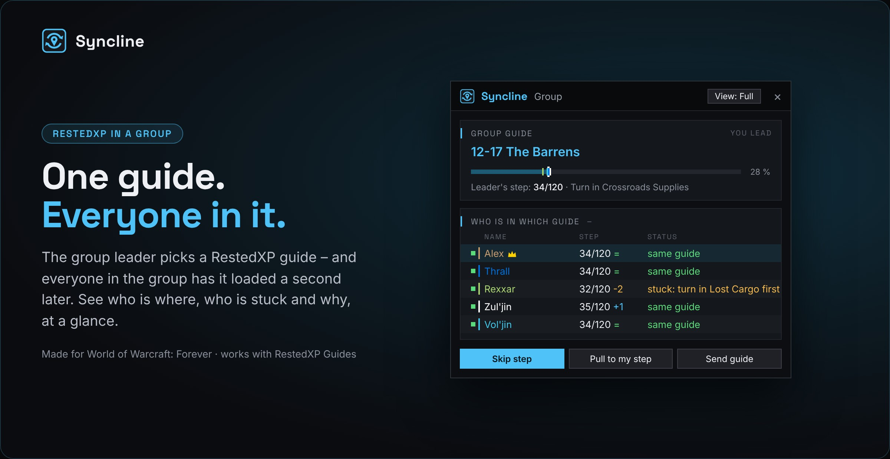

# Syncline

Hält die Gruppe im selben **RestedXP**-Guide: Der Gruppenleiter wählt einen Guide, alle anderen laden automatisch denselben.

Alle in der Gruppe brauchen RestedXP Guides **und** Syncline.

CurseForge-Beschreibung: [`docs/curseforge.md`](docs/curseforge.md)

## So funktioniert's
- Leiter wählt im RestedXP-Fenster einen Guide → geht sofort an die Gruppe.
- Wer der Gruppe beitritt oder sich einloggt/`/reload` macht, bekommt den Guide des Leiters automatisch.
- Im Kampf wird erst nach dem Kampf gewechselt.
- Mitglieder können dem Leiter einen Guide vorschlagen: einfach im RestedXP-Fenster wählen und im Popup „Vorschlagen“ klicken (oder `/sl vorschlagen`). Der Leiter klickt „Übernehmen“ und alle ziehen mit.
- Jeder behält seinen eigenen Fortschritt im Guide (RestedXP überspringt erledigte Schritte selbst).

## Deutscher und englischer Client gemischt
RestedXP lädt auf jedem Client die Guides in dessen Sprache, und die heißen unterschiedlich
(„RestedXP Forever Guide (H)“ gegen „RestedXP Forever Route (H)“, „The Barrens“ gegen „Das Brachland“).
Syncline schickt deshalb eine sprachunabhängige Guide-ID mit (`GuideMap.lua`, aus dem RestedXP-Quellcode
erzeugt) und jeder lädt die Fassung in seiner eigenen Sprache.

`GuideMap.lua` wird von `.github/workflows/guidemap.yml` täglich neu gebaut, wenn RestedXP seine Guides ändert.
Von Hand: `python3 tools/build_guidemap.py <Pfad zu RXPGuides> > GuideMap.lua`

## Fenster und Einstellungen
- **Minimap-Knopf**: Linksklick öffnet das Gruppenfenster, Rechtsklick die Einstellungen, Ziehen verschiebt ihn.
- **Gruppenfenster**: Gruppen-Guide, jedes Mitglied mit Status (grün gleicher Guide, rot anderer, grau kein Syncline, orange andere Version), Knöpfe „Guide nochmal senden“ (Leiter) bzw. „Guide des Leiters holen“ und „Meinen Guide vorschlagen“.
- **Einstellungen**: auch unter Esc → Optionen → AddOns → Syncline.

## Befehle
| Befehl | Was |
|---|---|
| `/sl` | Gruppenfenster: wer ist in welchem Guide |
| `/sl status` | das Gleiche im Chat |
| `/sl optionen` | Einstellungen |
| `/sl minimap` | Minimap-Knopf zeigen/verstecken |
| `/sl senden` | (Leiter) Guide nochmal an alle schicken |
| `/sl holen` | Guide des Leiters laden |
| `/sl vorschlagen` | meinen Guide dem Leiter vorschlagen |
| `/sl skippen` | Leiter: Schritt für alle überspringen, sonst beim Leiter anfragen |
| `/sl herholen` | Leiter: alle im Guide zu meinem Schritt holen |
| `/sl route` | Leiter: RestedXP-Routeneinstellungen (Dungeons, ...) nochmal senden |
| `/sl auto` / `fragen` | sofort wechseln / vorher Popup |
| `/sl an` / `aus` | Sync an/aus |
| `/sl version` | eigene Version |
| `/sl debug` | jede empfangene Nachricht im Chat zeigen |

## Tests
`lua5.1 tests/run.lua`
