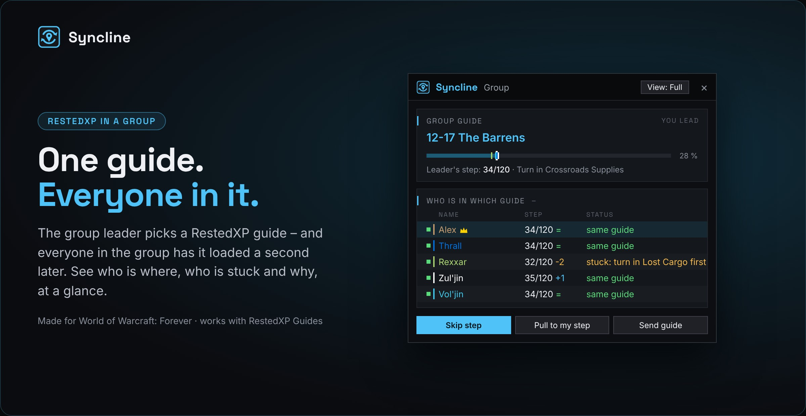
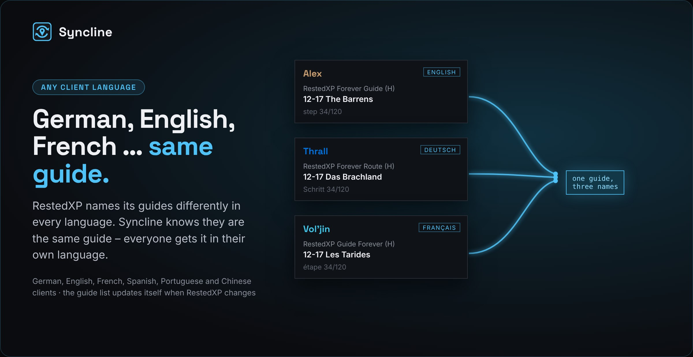
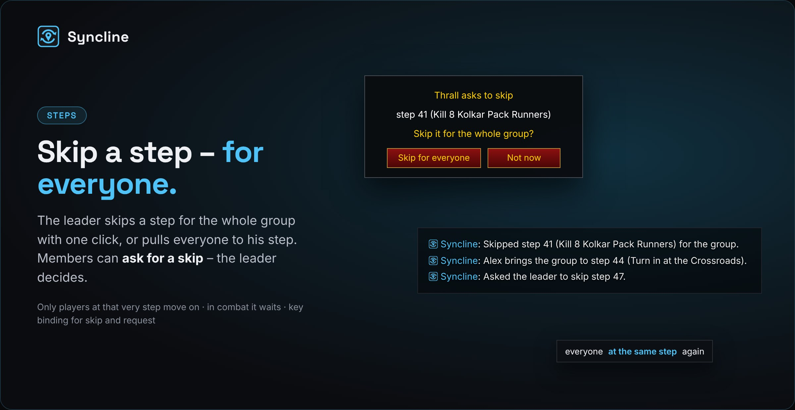
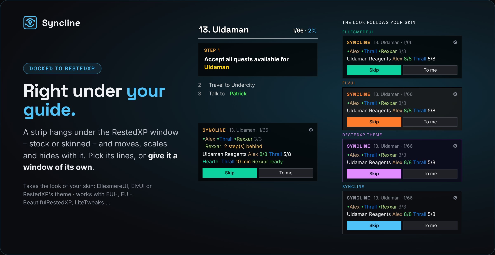
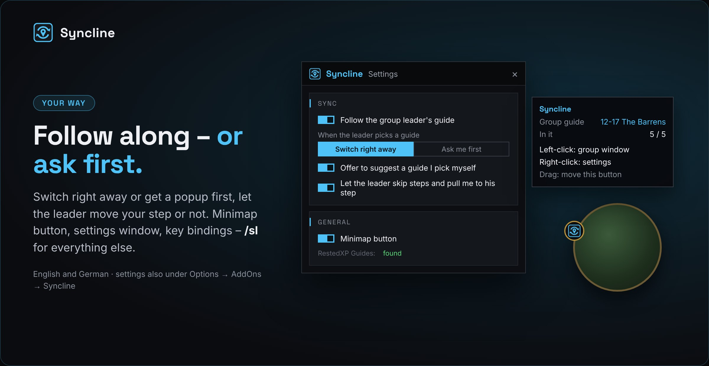

## One guide. Everyone in it.

**Syncline** keeps your leveling group in the same **RestedXP** guide: the **group leader picks a guide**, and a second later everyone in the group has it loaded – and you see at a glance **who is at which step**.

- **The leader decides:** pick a guide in the RestedXP window as usual – it goes to the whole group. Whoever joins, logs in or reloads gets it too
- **Any client language:** RestedXP names its guides differently in every language. Syncline knows they're the same guide – German, English, French, Spanish, Portuguese and Chinese clients play together
- **Who is where:** the group window shows every player's step and how far ahead or behind the leader they are, plus the leader's step with its text
- **Skip for everyone:** the leader skips a step for the whole group with one click, or pulls everyone to his step
- **Skip check:** before you skip, Syncline shows whether follow-up quests hang on the step – green: safe to skip, orange/red: these quests would be gone for the whole group
- **Ask for a skip:** members ask the leader to skip their step – he gets a popup and decides
- **Same route settings:** dungeons, skipping overleveled steps, group quests, Solo Self Found and the EXP rate decide which steps a guide has. The leader's settings go to the group, so everyone has the same steps
- **Suggest a guide:** pick another guide yourself and Syncline offers to suggest it to the leader. One click on *Take it*, and the whole group switches
- **Your way** (`/sl options`): switch right away or get asked first, let the leader move your step or not, minimap button, window size
- **Safe:** nothing switches in combat – it waits until combat ends

Made for **World of Warcraft: Forever**. English and German.

## Requirements

- **RestedXP Guides** (required).
- **Everyone in the group** needs Syncline – it's the group's addons that talk to each other.

## Commands

| Command | |
|---|---|
| `/sl` | open/close the group window |
| `/sl status` | who is in which guide at which step, in the chat |
| `/sl send` | (leader) send your guide to the group again |
| `/sl get` | load the leader's guide |
| `/sl suggest` | suggest your guide to the leader |
| `/sl skip` | leader: skip the step for everyone · others: ask the leader |
| `/sl pull` | (leader) everyone in the guide to your step |
| `/sl route` | (leader) send your RestedXP route settings again |
| `/sl auto` / `ask` | switch right away / ask first |
| `/sl on` / `off` | sync on or off |
| `/sl options` | settings |
| `/sl minimap` | show or hide the minimap button |

German clients can use the German words too (`/sl skippen`, `/sl holen`, `/sl optionen`, …).

Minimap button: left click opens the group window, right click the settings, drag to move it. Key bindings for *skip / request skip* and the group window: *Key Bindings → AddOns → Syncline*.

## Source

[github.com/Drakner-chio/syncline](https://github.com/Drakner-chio/syncline) – MIT licence. Bugs and ideas welcome as issues.
